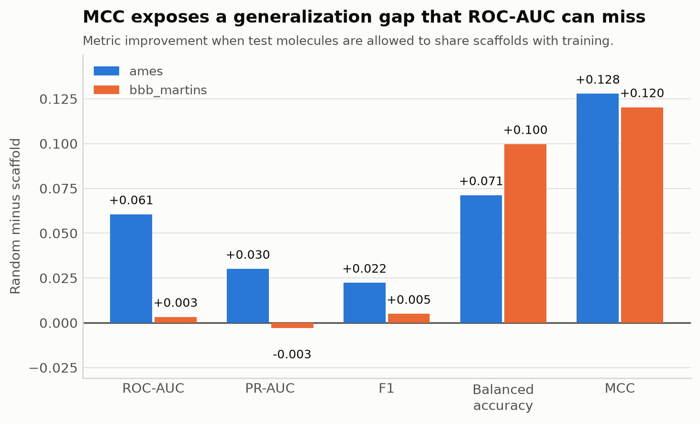

# ADMET-ML — Predicting Drug Properties from Molecular Structure

Classical machine learning baselines for two ADMET endpoints that matter early in
drug discovery: **does a molecule reach the brain**, and **is it mutagenic**.
Built on RDKit features and scikit-learn, benchmarked under the Therapeutics Data
Commons (TDC) protocol, and shipped with an interactive demo.

> **TL;DR** — A Random Forest on RDKit features reaches **0.924 ± 0.024 ROC-AUC**
> on blood-brain barrier penetration under TDC's scaffold split, in the same
> range as published leaderboard entries (~0.92) — trained in under three minutes
> on a laptop CPU, with no GPU and no neural network. On Ames mutagenicity,
> XGBoost reaches **0.856 ± 0.003**.
>
> The more useful findings are about *evaluation*: a model that ignores the
> molecule entirely scores **F1 = 0.879** on BBB, and on that same dataset
> ROC-AUC shows **no generalization gap at all** (+0.003) while MCC shows a large
> one (+0.120). Headline metrics on imbalanced chemical data are easy to fake,
> and most of this repository is about not fooling yourself.

<!-- Add after deploying: [**▶ Try the live demo**](https://your-app.streamlit.app) -->

---

## Results

Entries are mean ± standard deviation over three seeds (42, 43, 44). The test set
is scored once per run, after hyperparameters and the decision threshold have
been chosen on training and validation data respectively.

### Blood-brain barrier penetration (BBB_Martins, n=1,975)

**Scaffold split — TDC's official protocol.** Test molecules belong to chemical
series the model never saw.

| Model | ROC-AUC | PR-AUC | F1 | MCC | Balanced acc. | Train time |
|---|---|---|---|---|---|---|
| Dummy (baseline) | 0.500 ± 0.000 | 0.785 ± 0.026 | 0.879 ± 0.016 | 0.000 ± 0.000 | 0.500 ± 0.000 | 0s |
| Logistic Regression | 0.910 ± 0.026 | 0.964 ± 0.011 | 0.916 ± 0.013 | 0.562 ± 0.036 | 0.731 ± 0.056 | 17s |
| **Random Forest** | **0.924 ± 0.024** | 0.971 ± 0.008 | 0.916 ± 0.009 | 0.569 ± 0.016 | 0.740 ± 0.051 | 161s |
| XGBoost | 0.916 ± 0.022 | 0.969 ± 0.004 | 0.920 ± 0.009 | 0.564 ± 0.012 | 0.720 ± 0.024 | 268s |

**Random split** — the easier, more commonly reported setting.

| Model | ROC-AUC | PR-AUC | F1 | MCC | Balanced acc. | Train time |
|---|---|---|---|---|---|---|
| Dummy (baseline) | 0.500 ± 0.000 | 0.744 ± 0.018 | 0.853 ± 0.012 | 0.000 ± 0.000 | 0.500 ± 0.000 | 0s |
| Logistic Regression | 0.919 ± 0.008 | 0.967 ± 0.003 | 0.918 ± 0.004 | 0.671 ± 0.031 | 0.825 ± 0.043 | 15s |
| **Random Forest** | **0.921 ± 0.027** | 0.964 ± 0.013 | 0.924 ± 0.019 | 0.689 ± 0.095 | 0.831 ± 0.039 | 170s |
| XGBoost | 0.920 ± 0.024 | 0.964 ± 0.009 | 0.925 ± 0.011 | 0.695 ± 0.054 | 0.834 ± 0.015 | 252s |

<picture>
  <source media="(prefers-color-scheme: dark)" srcset="results/figures/bbb_martins_model_comparison_dark.png">
  
</picture>

### Ames mutagenicity (AMES, n=7,255)

**Scaffold split — TDC's official protocol.**

| Model | ROC-AUC | PR-AUC | F1 | MCC | Balanced acc. | Train time |
|---|---|---|---|---|---|---|
| Dummy (baseline) | 0.500 ± 0.000 | 0.604 ± 0.014 | 0.753 ± 0.011 | 0.000 ± 0.000 | 0.500 ± 0.000 | 3s |
| Logistic Regression | 0.793 ± 0.031 | 0.840 ± 0.036 | 0.787 ± 0.020 | 0.412 ± 0.101 | 0.693 ± 0.067 | 30s |
| Random Forest | 0.848 ± 0.011 | 0.885 ± 0.009 | 0.833 ± 0.013 | 0.557 ± 0.023 | 0.769 ± 0.018 | 367s |
| **XGBoost** | **0.856 ± 0.003** | 0.894 ± 0.005 | 0.827 ± 0.015 | 0.548 ± 0.021 | 0.762 ± 0.026 | 248s |

**Random split.**

| Model | ROC-AUC | PR-AUC | F1 | MCC | Balanced acc. | Train time |
|---|---|---|---|---|---|---|
| Dummy (baseline) | 0.500 ± 0.000 | 0.544 ± 0.006 | 0.704 ± 0.005 | 0.000 ± 0.000 | 0.500 ± 0.000 | 2s |
| Logistic Regression | 0.859 ± 0.017 | 0.869 ± 0.020 | 0.817 ± 0.013 | 0.573 ± 0.031 | 0.780 ± 0.017 | 27s |
| Random Forest | 0.910 ± 0.004 | 0.920 ± 0.004 | 0.848 ± 0.007 | 0.660 ± 0.030 | 0.826 ± 0.021 | 376s |
| **XGBoost** | **0.910 ± 0.004** | 0.921 ± 0.004 | 0.849 ± 0.003 | 0.667 ± 0.018 | 0.832 ± 0.012 | 253s |

<picture>
  <source media="(prefers-color-scheme: dark)" srcset="results/figures/ames_model_comparison_dark.png">
  
</picture>

AMES is the harder endpoint (0.856 vs 0.924) and the better-behaved benchmark:
it is nearly balanced at 55% positive, the models separate cleanly from the
linear baseline, and XGBoost's seed-to-seed spread is tiny (±0.003).

---

## Three findings worth the read

### 1. A model that ignores the molecule scores F1 = 0.879

BBB_Martins is 76% positive. Predict "crosses the barrier" for every molecule and
you get high accuracy and a high F1 — while having learned nothing. The `Dummy`
row is in every table for exactly this reason, and MCC (0.000) and ROC-AUC (0.500)
are the metrics that catch it.

This is why the headline metric here is ROC-AUC and MCC, never accuracy or F1.

### 2. MCC exposes a generalization gap that ROC-AUC can miss

Comparing each metric between the two splits, averaged over the three real
models:

<picture>
  <source media="(prefers-color-scheme: dark)" srcset="results/figures/generalization_gap_dark.png">
  
</picture>

| Metric | AMES | BBB_Martins |
|---|---|---|
| ROC-AUC | +0.061 | **+0.003** |
| PR-AUC | +0.030 | −0.003 |
| F1 | +0.022 | +0.005 |
| Balanced accuracy | +0.071 | +0.100 |
| MCC | **+0.128** | **+0.120** |

**MCC falls by roughly 0.12 on both datasets** when the model has to handle
unseen scaffolds. ROC-AUC is inconsistent: it registers a clear 0.061 drop on
AMES, but essentially nothing on BBB_Martins.

So on BBB, a report using only ROC-AUC — the metric the TDC leaderboard ranks on
— would conclude there is *no* generalization problem, while MCC shows a large
one. What degrades under a scaffold split is mostly *threshold-dependent*
performance: a cutoff chosen on validation data transfers poorly when the test
chemistry is unfamiliar, even though the model's ability to *rank* molecules
survives.

Two caveats. TDC's scaffold split shuffles scaffold *groups* rather than
deliberately putting the most dissimilar chemistry in test, so it is a realistic
protocol rather than a worst case. And BBB_Martins is small (396 test molecules),
so its ROC-AUC estimates are noisy (±0.024).

### 3. The "best model" differences are mostly smaller than the seed noise

On BBB, Random Forest leads XGBoost 0.924 to 0.916 — but the seed-to-seed
standard deviation is ±0.024, three times the gap. The honest conclusion is that
they are indistinguishable there. One Random Forest seed scored 0.952 alone; a
single-seed run would have reported that as the result.

AMES, being 3.7× larger, is better behaved: XGBoost's spread is ±0.003 and it
edges Random Forest 0.856 to 0.848 on the scaffold split. Even there the margin
is slim.

The transferable lesson: at these dataset sizes, three seeds are the minimum
needed before claiming any model beats another — and tuned Logistic Regression
is within 0.014 of the best model on BBB while training 10× faster.

---

## What the model learned

A good score is not evidence that a model learned chemistry — it may have learned
an artefact of the split. So the descriptors driving its predictions are checked
against what medicinal chemistry already knows about getting a drug into the
brain.

SHAP values are computed on a descriptor-only XGBoost model, since individual
fingerprint bits mean nothing to a reader while descriptors are quantities a
chemist recognises.

<picture>
  <source media="(prefers-color-scheme: dark)" srcset="results/figures/bbb_martins_descriptor_importance_dark.png">
  
</picture>

**The top descriptor is TPSA** — topological polar surface area — by a factor of
nearly two over anything else. That is precisely what CNS drug design predicts: a
polar molecule does not cross the blood-brain barrier.

Checking the direction of the four descriptors with well-established expectations:

| Descriptor | Expected | Observed | Correlation |
|---|---|---|---|
| TPSA (polar surface area) | ↓ lowers penetration | ↓ | −0.81 |
| NumHDonors (H-bond donors) | ↓ lowers penetration | ↓ | −0.56 |
| NHOHCount (NH/OH groups) | ↓ lowers penetration | ↓ | −0.70 |
| MolLogP (lipophilicity) | ↑ raises penetration | ↑ | +0.42 |

**All four match.** The model recovered the polarity-versus-lipophilicity
trade-off at the heart of CNS drug design from 1,382 training molecules, without
being told any of it. `qed` — RDKit's drug-likeness score — also ranks highly
(r = +0.91), which is consistent: BBB-penetrant compounds tend to be
small, non-polar, orally-drug-like molecules.

This check runs as part of `scripts/explain.py` and prints MATCHES or DIFFERS for
each descriptor, so it is a reproducible assertion rather than a story told after
the fact.

<picture>
  <source media="(prefers-color-scheme: dark)" srcset="results/figures/bbb_martins_roc_curves_dark.png">
  
</picture>

---

## Method

| Step | Choice | Why |
|---|---|---|
| Features | 2048-bit Morgan fingerprints (radius 2) + 217 RDKit descriptors | Fingerprints carry substructure signal; descriptors are interpretable |
| Split | Scaffold (TDC official) and random, 70/10/20 | Reporting both exposes the evaluation gap above |
| Tuning | `RandomizedSearchCV` inside the training split | Equal budget per model within a dataset |
| Threshold | Chosen on validation to maximise F1 | Tuning it on test would leak |
| Seeds | 42, 43, 44 | Single-seed claims are not trustworthy at this effect size |
| Metrics | ROC-AUC (headline), PR-AUC, F1, MCC, balanced accuracy | No single metric is safe on imbalanced data |

**Search budget:** 20 trials × 5-fold CV for BBB_Martins; 10 trials × 3-fold for
AMES, which is 3.7× larger. Every model within a dataset gets an identical
budget — that is what makes the comparison fair.

**Leakage controls.** Imputation and scaling live inside the sklearn `Pipeline`,
so they are fitted per CV fold rather than on the whole dataset. Molecules are
deduplicated on canonical SMILES before splitting. The test set is touched once.
A test asserts no molecule and no scaffold appears in both train and test.

### Data

Downloaded directly from the Harvard Dataverse files behind TDC. The loader
reproduces TDC's published dataset sizes exactly — **1,975** molecules for
BBB_Martins and **7,255** for AMES — which is the check that the deduplication
matches theirs.

This project deliberately does **not** depend on the `PyTDC` package: it pins
`numpy<2`, `pandas<3` and `rdkit<2024`, and pulls in a protein and single-cell
stack irrelevant to small-molecule work. The scaffold split is reimplemented from
`tdc.utils.split.create_scaffold_split` (itself chemprop's balanced scaffold
split), so the protocol matches while the install stays clean.

Because the splits are regenerated locally rather than downloaded, these numbers
are a like-for-like *protocol* comparison with the TDC leaderboard, not a
submission scored on identical splits.

---

## Reproduce

```bash
git clone https://github.com/Adithyrao1/admet-ml.git
cd admet-ml
pip install -r requirements.txt
pip install -e .

pytest -q                      # 26 tests
make all                       # or run the scripts below
```

```bash
python scripts/run_experiment.py --all          # the full sweep, resumable
python scripts/analyze.py                       # tables + figures
python scripts/explain.py --dataset bbb_martins # SHAP + pharmacology check
```

The sweep writes a row to `results/results.csv` after every run and skips runs
already present, so an interrupted session resumes where it stopped. The full
48-run sweep takes roughly 2–3 hours on a laptop CPU (measured: 47 minutes for
BBB_Martins, the rest for the 3.7× larger AMES). Individual pieces are much
faster — a single tuned model is seconds to a few minutes.

### Demo

```bash
python scripts/build_artifacts.py     # pre-train the served models (~3.5 MB)
streamlit run app/streamlit_app.py
```

Deployment steps are in [docs/DEPLOY.md](docs/DEPLOY.md). The app runs
server-side: the browser sends a SMILES string over a WebSocket, Python does the
featurization and inference, and the result renders back. Models are pre-trained
into `models/` rather than fitted at startup, so a cold start costs a second
instead of a minute.

Five tabs, because a prediction box alone says nothing about whether the
predictions deserve trust:

| Tab | What it shows |
|---|---|
| **Predict** | Structure, physicochemical profile, Lipinski check, both endpoint probabilities, and a per-molecule SHAP breakdown of *why* |
| **Benchmark** | The 48-run table, filterable, with the Dummy baseline kept in view |
| **Why the split matters** | Toggle scaffold ↔ random and watch MCC move while ROC-AUC barely does |
| **What it learned** | SHAP ranking plus the pharmacology check as a live pass/fail table |
| **Where it fails** | Held-out molecules with true labels, memorised molecules flagged as such, and the Sucrose extrapolation |

**Every prediction is labelled `train`, `holdout` or `unseen`.** A molecule the
model memorised is marked as recall rather than evidence, which is the
difference between a demo that proves something and one that just looks
convincing — Caffeine, Atenolol, Aspirin and 2-Nitrofluorene are all in the
training data.

---

## Project structure

```
src/admet/
  data.py        download, canonicalize, deduplicate, random + scaffold splits
  features.py    SMILES -> Morgan fingerprints + RDKit descriptors (cached)
  models.py      Dummy / LogReg / RandomForest / XGBoost pipelines + search spaces
  evaluate.py    ROC-AUC, PR-AUC, F1, MCC, balanced accuracy, confusion matrix
  experiment.py  one run end to end; appends to the results CSV
  domain.py      pharmacology expectations, written down before seeing results
  plots.py       figures, rendered for light and dark themes
scripts/
  run_experiment.py   resumable sweep CLI
  analyze.py          results CSV -> summary tables + figures
  explain.py          ROC curves, SHAP, pharmacology direction check
  build_artifacts.py  pre-train the models the demo serves
app/streamlit_app.py  five-tab interactive demo
models/               pre-trained models, training SMILES, holdout sets (3.5 MB)
tests/                26 tests: leakage, baseline invariants, artifacts, app run
```

---

## Where it fails

Spot-checking a demo on famous drugs is close to worthless, because the famous
drugs are usually *in the training set*. Checking membership explicitly:

| Molecule | Prediction | Status | What it proves |
|---|---|---|---|
| Caffeine | 97.6% BBB | **in training** | nothing — recall |
| Atenolol | 3.2% BBB | **in training** | nothing — recall |
| Aspirin | — | **in training** | nothing — recall |
| 2-Nitrofluorene | 97.2% Ames | **in training** | nothing — recall |
| **Sucrose** | **53.0% BBB** | **not in dataset** | a real limitation |

Sucrose is the honest failure. It is a highly polar sugar that certainly does
not reach the brain, and the model returns a coin flip. Its nearest training
neighbour sits at Tanimoto 0.41 and sugars are barely represented among the
1,382 training molecules, so this is extrapolation rather than judgement — and
the expected answer comes from pharmacology, not from the benchmark, since
sucrose carries no BBB label at all.

This is why the app labels every prediction `train` / `holdout` / `unseen`, and
why the "Where it fails" tab draws its evidence from genuinely held-out
molecules with known labels instead of from recognisable drug names.

## Limitations

- **Two endpoints only.** No ADME regression tasks (solubility, clearance) and no
  multi-task modelling.
- **Small datasets.** 2k and 7k molecules. Conclusions about model ranking are
  specific to this scale; at 100k molecules a neural model would likely lead.
- **No applicability domain model.** The demo reports nearest-neighbour Tanimoto
  similarity as a proxy, which is a heuristic, not a calibrated confidence.
- **Ames mutagenicity is one assay**, not a full genotoxicity assessment.
- **Not for clinical, regulatory or safety decisions.**

## License

MIT
