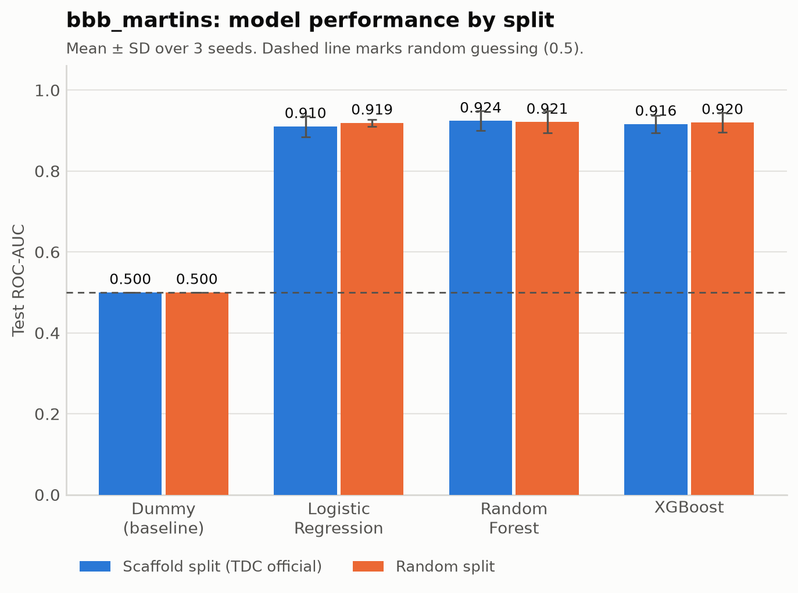
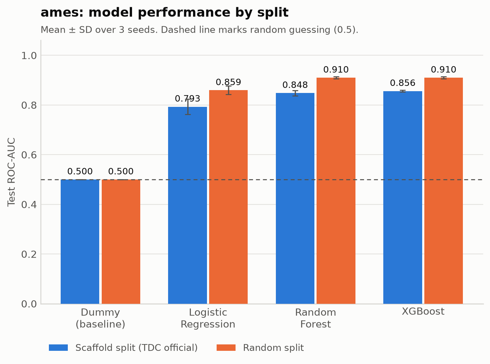
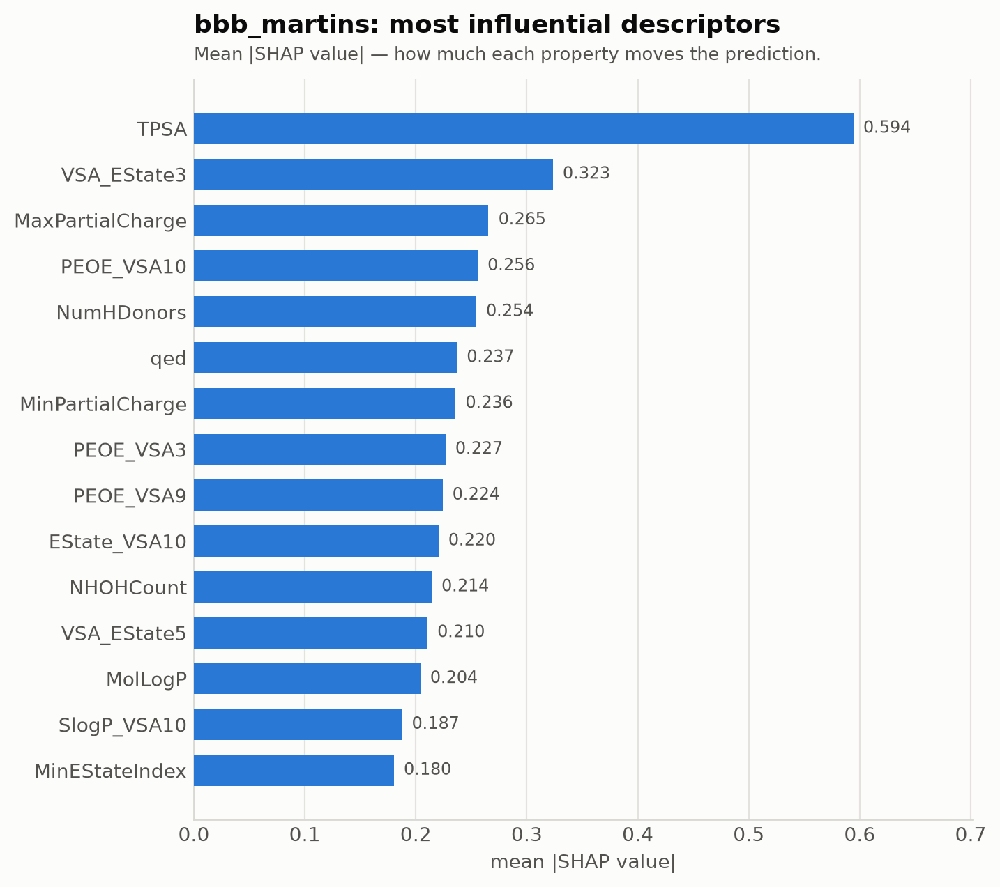
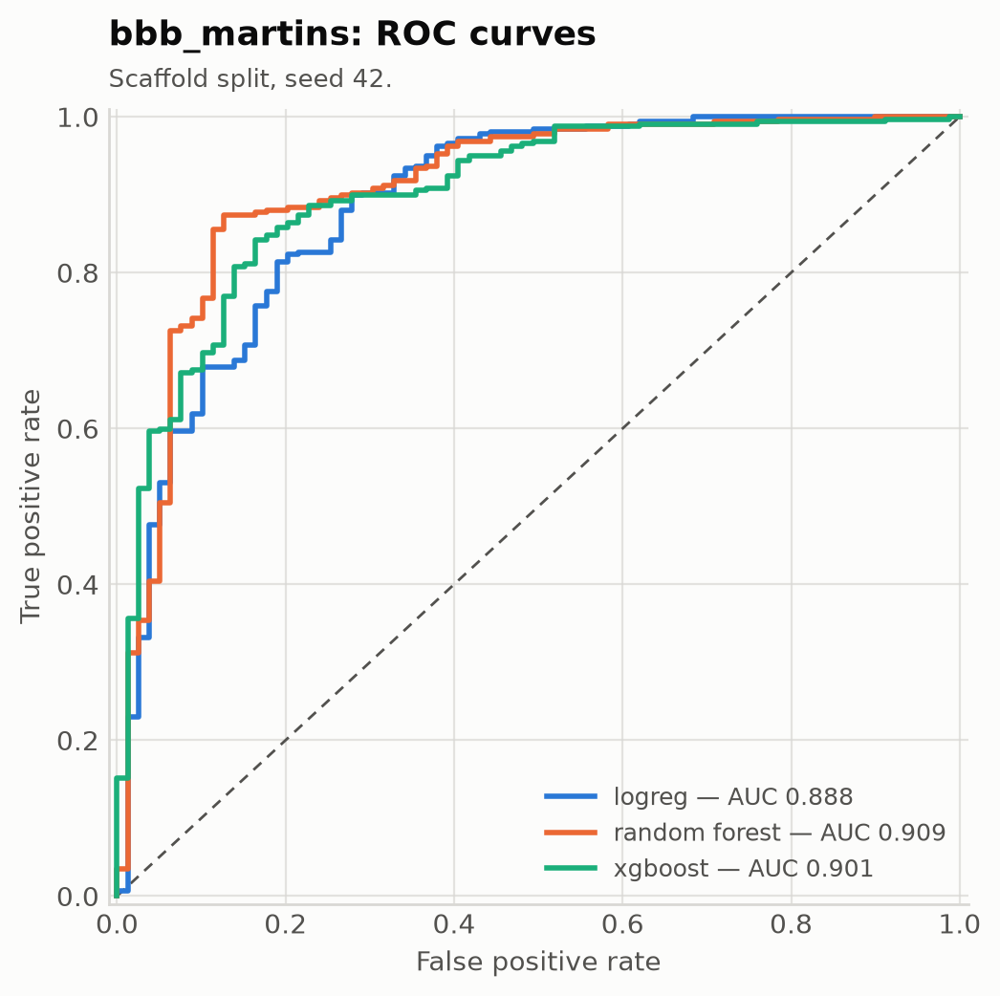

# ADMET-ML

Classical ML baselines for two ADMET endpoints: blood-brain barrier penetration
(BBB_Martins) and Ames mutagenicity (AMES). RDKit features, scikit-learn and
XGBoost, benchmarked under the Therapeutics Data Commons (TDC) protocol.

## Project details

| Item | Detail |
|---|---|
| Datasets | BBB_Martins (1,975 molecules), AMES (7,255 molecules), from the Harvard Dataverse files behind TDC |
| Features | 2048-bit Morgan fingerprints (radius 2) and 217 RDKit descriptors |
| Models | Dummy baseline, Logistic Regression, Random Forest, XGBoost |
| Splits | Scaffold (TDC official) and random, 70/10/20 |
| Tuning | `RandomizedSearchCV` inside the training split: 20 trials x 5-fold for BBB, 10 trials x 3-fold for AMES |
| Threshold | Chosen on the validation set to maximise F1 |
| Seeds | 42, 43, 44 |
| Metrics | ROC-AUC, PR-AUC, F1, MCC, balanced accuracy |
| Leakage controls | Imputation and scaling inside the sklearn `Pipeline`, deduplication on canonical SMILES before splitting, test set scored once |

## Results

Mean ± standard deviation over three seeds.

### BBB_Martins, scaffold split

| Model | ROC-AUC | PR-AUC | F1 | MCC | Balanced acc. | Train time |
|---|---|---|---|---|---|---|
| Dummy (baseline) | 0.500 ± 0.000 | 0.785 ± 0.026 | 0.879 ± 0.016 | 0.000 ± 0.000 | 0.500 ± 0.000 | 0s |
| Logistic Regression | 0.910 ± 0.026 | 0.964 ± 0.011 | 0.916 ± 0.013 | 0.562 ± 0.036 | 0.731 ± 0.056 | 17s |
| **Random Forest** | **0.924 ± 0.024** | 0.971 ± 0.008 | 0.916 ± 0.009 | 0.569 ± 0.016 | 0.740 ± 0.051 | 161s |
| XGBoost | 0.916 ± 0.022 | 0.969 ± 0.004 | 0.920 ± 0.009 | 0.564 ± 0.012 | 0.720 ± 0.024 | 268s |

### BBB_Martins, random split

| Model | ROC-AUC | PR-AUC | F1 | MCC | Balanced acc. | Train time |
|---|---|---|---|---|---|---|
| Dummy (baseline) | 0.500 ± 0.000 | 0.744 ± 0.018 | 0.853 ± 0.012 | 0.000 ± 0.000 | 0.500 ± 0.000 | 0s |
| Logistic Regression | 0.919 ± 0.008 | 0.967 ± 0.003 | 0.918 ± 0.004 | 0.671 ± 0.031 | 0.825 ± 0.043 | 15s |
| **Random Forest** | **0.921 ± 0.027** | 0.964 ± 0.013 | 0.924 ± 0.019 | 0.689 ± 0.095 | 0.831 ± 0.039 | 170s |
| XGBoost | 0.920 ± 0.024 | 0.964 ± 0.009 | 0.925 ± 0.011 | 0.695 ± 0.054 | 0.834 ± 0.015 | 252s |

<picture>
  <source media="(prefers-color-scheme: dark)" srcset="results/figures/bbb_martins_model_comparison_dark.png">
  
</picture>

### AMES, scaffold split

| Model | ROC-AUC | PR-AUC | F1 | MCC | Balanced acc. | Train time |
|---|---|---|---|---|---|---|
| Dummy (baseline) | 0.500 ± 0.000 | 0.604 ± 0.014 | 0.753 ± 0.011 | 0.000 ± 0.000 | 0.500 ± 0.000 | 3s |
| Logistic Regression | 0.793 ± 0.031 | 0.840 ± 0.036 | 0.787 ± 0.020 | 0.412 ± 0.101 | 0.693 ± 0.067 | 30s |
| Random Forest | 0.848 ± 0.011 | 0.885 ± 0.009 | 0.833 ± 0.013 | 0.557 ± 0.023 | 0.769 ± 0.018 | 367s |
| **XGBoost** | **0.856 ± 0.003** | 0.894 ± 0.005 | 0.827 ± 0.015 | 0.548 ± 0.021 | 0.762 ± 0.026 | 248s |

### AMES, random split

| Model | ROC-AUC | PR-AUC | F1 | MCC | Balanced acc. | Train time |
|---|---|---|---|---|---|---|
| Dummy (baseline) | 0.500 ± 0.000 | 0.544 ± 0.006 | 0.704 ± 0.005 | 0.000 ± 0.000 | 0.500 ± 0.000 | 2s |
| Logistic Regression | 0.859 ± 0.017 | 0.869 ± 0.020 | 0.817 ± 0.013 | 0.573 ± 0.031 | 0.780 ± 0.017 | 27s |
| Random Forest | 0.910 ± 0.004 | 0.920 ± 0.004 | 0.848 ± 0.007 | 0.660 ± 0.030 | 0.826 ± 0.021 | 376s |
| **XGBoost** | **0.910 ± 0.004** | 0.921 ± 0.004 | 0.849 ± 0.003 | 0.667 ± 0.018 | 0.832 ± 0.012 | 253s |

<picture>
  <source media="(prefers-color-scheme: dark)" srcset="results/figures/ames_model_comparison_dark.png">
  
</picture>

### Change in each metric, random split minus scaffold split

Averaged over the three non-baseline models.

| Metric | AMES | BBB_Martins |
|---|---|---|
| ROC-AUC | +0.061 | +0.003 |
| PR-AUC | +0.030 | -0.003 |
| F1 | +0.022 | +0.005 |
| Balanced accuracy | +0.071 | +0.100 |
| MCC | +0.128 | +0.120 |

<picture>
  <source media="(prefers-color-scheme: dark)" srcset="results/figures/generalization_gap_dark.png">
  
</picture>

### Feature attribution (BBB_Martins)

SHAP values from a descriptor-only XGBoost model.

<picture>
  <source media="(prefers-color-scheme: dark)" srcset="results/figures/bbb_martins_descriptor_importance_dark.png">
  
</picture>

| Descriptor | Expected effect | Observed effect | Correlation |
|---|---|---|---|
| TPSA | Lowers penetration | Lowers | -0.81 |
| NumHDonors | Lowers penetration | Lowers | -0.56 |
| NHOHCount | Lowers penetration | Lowers | -0.70 |
| MolLogP | Raises penetration | Raises | +0.42 |

<picture>
  <source media="(prefers-color-scheme: dark)" srcset="results/figures/bbb_martins_roc_curves_dark.png">
  
</picture>

## Reproduce

```bash
git clone https://github.com/Adithyrao1/admet-ml.git
cd admet-ml
pip install -r requirements.txt
pip install -e .

pytest -q
python scripts/run_experiment.py --all
python scripts/analyze.py
python scripts/explain.py --dataset bbb_martins
```

## Demo

```bash
python scripts/build_artifacts.py
streamlit run app/streamlit_app.py
```

Tabs: Predict, Benchmark, Splits, Interpretability, Limitations. Deployment
steps are in [docs/DEPLOY.md](docs/DEPLOY.md).

## Project structure

```
src/admet/
  data.py        download, canonicalize, deduplicate, random + scaffold splits
  features.py    SMILES -> Morgan fingerprints + RDKit descriptors
  models.py      Dummy / LogReg / RandomForest / XGBoost pipelines
  evaluate.py    ROC-AUC, PR-AUC, F1, MCC, balanced accuracy
  experiment.py  one run end to end; appends to the results CSV
  domain.py      pharmacology expectations for the direction check
  plots.py       figures for light and dark themes
scripts/
  run_experiment.py   resumable sweep CLI
  analyze.py          results CSV -> summary tables + figures
  explain.py          ROC curves, SHAP, direction check
  build_artifacts.py  pre-train the models the demo serves
app/streamlit_app.py  interactive demo
models/               pre-trained models and holdout sets
tests/                26 tests
```

## License

MIT
